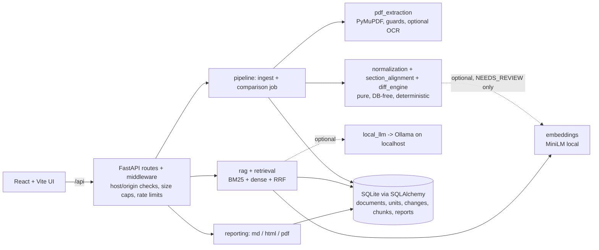

# Architecture



Deterministic findings (blue path) never depend on the optional components (dotted). Without Ollama or the embedding model the app still extracts, compares, highlights, answers extractively with citations, and exports reports.

```
React (Vite) ──/api──▶ FastAPI routes ──▶ services ──▶ SQLAlchemy (SQLite | PostgreSQL)
                                │             ├─ pdf_extraction  (PyMuPDF, optional OCR)
                                │             ├─ normalization   (meaning-preserving)
                                │             ├─ section_alignment + diff_engine  (pure, DB-free)
                                │             ├─ embeddings / retrieval / rag
                                │             ├─ local_llm       (Ollama only)
                                │             └─ reporting       (md / html / pdf)
                                └─ BackgroundTasks → pipeline.run_comparison (stages, deadline, retry)
```

`app/services/{section_alignment,diff_engine,normalization}.py` take plain dataclasses, so the algorithm is unit-tested without PDFs or a database.
Routers only validate and orchestrate; `pipeline.py` owns ingestion and the job.

## Normalization
NFKC (folds ligatures / nbsp / full-width forms), quote & dash folding, zero-width removal, whitespace collapse, line-break de-hyphenation
(only `xxx-⏎yyy` with lowercase continuation; compound prefixes `non-`, `self-`, `co-`… keep the hyphen). Case, punctuation, digits, `%`, currency,
negations, modals and legal references are preserved. `match_key` (case/punctuation-insensitive) is used **only to find candidates**; equality for `UNCHANGED` uses the stricter text,
unless `ignore_punctuation_case` is chosen. Leading clause numbers are split off so renumbered-but-identical clauses match; they are `UNCHANGED` + `renumbered` flag
(or `MODIFIED` with `renumbering_is_change`).

## Alignment (section_alignment.py)
1. **Exact anchors** — `difflib.SequenceMatcher` over normalized texts (order-preserving, handles duplicates and repeated headings by order).
2. **1b Exact relocation** — identical text left over at a different position → `POSSIBLY_RELOCATED` (ambiguous duplicates → `NEEDS_REVIEW`).
3. **Fuzzy DP** inside each gap between anchors: max-total-similarity order-preserving matching. Similarity = geometric mean of character ratio and word overlap (+ small same-section/kind bonuses; short strings damped).
   ≥0.75 → `MODIFIED`; 0.50–0.75 → `NEEDS_REVIEW`; below → unmatched.
4. **Pass 2 global relocation** — fuzzy ≥0.88 across the whole document; runner-up within 0.03 → `NEEDS_REVIEW`.
5. **Semantic** (optional MiniLM cosine ≥0.78) — leftovers only, **never auto-confirmed**: always `NEEDS_REVIEW`. Vector similarity never decides deletion alone.
Leftovers: `ADDED` / `REMOVED`. Thresholds live in `AlignConfig`.

## Data model
`documents`, `pages` (extracted text), `units` (structure), `comparisons` (status/stage/progress/error/limitations), `changes`, `chunks` (text + float32 embedding blob),
`reports`. Cascades implement retention: **deleting a document removes its file, pages, units, chunks/embeddings, every comparison that uses it, their changes, and generated reports.**
`RETENTION_DAYS=N` purges older documents at startup. Identical bytes are stored once (SHA-256 dedup); chunk ids are content hashes, so indexing is idempotent.
Schema is created by `create_all`; for PostgreSQL set `DATABASE_URL` (install `psycopg`). Embeddings are stored as blobs and searched with NumPy; a pgvector store can replace
`retrieval.search`'s dense branch without touching callers. (No Alembic migrations yet.)

## Retrieval & RAG
Chunks follow heading boundaries (≤900 chars; overlap of one sentence only when a single paragraph must be split). BM25 (Lucene IDF), dense cosine, hybrid = Reciprocal Rank Fusion (k=60), optional cross-encoder rerank.
`rag.answer`: intent routing (removed/added/changed) adds deterministic change records as evidence; sufficiency check (query-term coverage ≥0.34 or cosine ≥0.35) else *"insufficient evidence"*;
Ollama prompt fences evidence as untrusted data; `[E#]` citations are validated against the evidence list; without an LLM an extractive, cited answer is returned.
